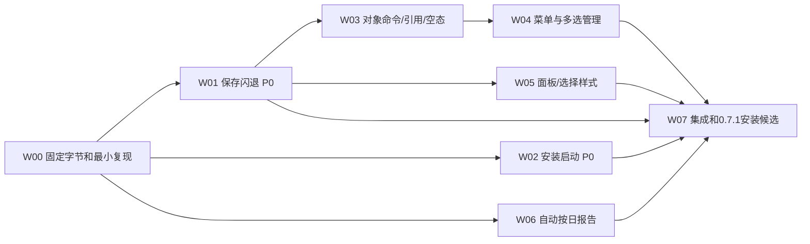

# AITSnap v0.7.1 修正轮：现象、边界与开发方案（待 Owner 审计）

日期：2026-11-01（北京时间）。状态：**DRAFT_FOR_OWNER_REVIEW**。本轮只读核对源码/相关崩溃日志并形成方案，没有修改产品代码、版本、真实配置或安装；没有复现桌面操作、重打包或推送PR。

源码基线 `7c6a717a1234204bebf01ea2c4fc50cd5a04bebe`；已交付包的产品源码 `69897b90bdda417958f2e04df9910ed1bf8b372a`。目标版本 **0.7.1**。已知 P0 应阻断新版本的发布判定；0.7.0 的局部组件 PASS 不再被用来推断保存/启动可用。

## 1. 证据与结论的分级

- **OWNER_REPORT**：Owner 的使用反馈，按真实故障受理，不以“我这里组件测试通过”否认。
- **OBSERVED**：本轮截图/文件哈希/事件日志直接观察。
- **SOURCE_FACT**：当前源码直接支持的事实。
- **CODE_RISK**：源码中需要用复现和调用栈判定的风险，不是根因结论。
- **PROPOSAL**：v0.7.1 的建议行为，供本轮审计。
- **UNPROVEN**：未取得精确证据；不能写已修复或验收通过。

只读发现：已安装 `aitsnap.exe` 为 0.7.0，SHA256 `a02e8279dbdbb96c9b0e7797cf628e2ea21dfbd17d9d5a842a2a59e0d74f13c3`，与交付离线包中的主程序完全相同。未运行该程序获取此结论。

Windows Application 日志中，该安装目录的 0.7.0 有以下 Event1000：

| 北京时间（2026-11-01） | 异常码 | 日志列出的模块 | 当前能证明什么 |
| --- | --- | --- | --- |
| 15:35:43.817 | c0000374 | ntdll.dll | 一次进程崩溃，检测到堆损坏 |
| 15:36:20.553 | c0000005 | Qt6Core.dll 6.12.0 | 一次访问异常崩溃 |
| 15:40:44.571 | c0000374 | ntdll.dll | 再次检测到堆损坏 |

异常类型参考[微软应用崩溃说明](https://github.com/MicrosoftDocs/SupportArticles-docs/blob/main/support/windows-server/performance/troubleshoot-application-service-crashing-behavior.md)。**异常落在 ntdll/Qt6Core 不等于根因在 Windows/Qt**；检测点可能晚于错误内存写入点。三条日志没有业务动作标记，不能把它们逐条强行对应“安装启动”或“保存拼图”，也不能据此证明两种故障同源。

脱敏日志、截图副本及哈希保存在 ignored `out/AITSNAP-V1-GOAL-TRAIN-001/UX071-AUDIT/`。Owner 截图包含实际工作屏幕，未加入公开计划资产；未读取内存转储。

## 2. 现象清单与优先级

| 编号 | 优先级 | 现象 | 核对结果 | v0.7.1 目标 |
| --- | --- | --- | --- | --- |
| BUG-071-01 | P0 | 安装完成页最后启动，进入白屏/卡死 | OWNER_REPORT；此前 Finish→可见可交互始终 HOLD；现有隐藏 smoke 没覆盖这个入口 | 取得精确启动链路/首帧/响应证据，修正实际原因 |
| BUG-071-02 | P0 | 新建拼图设置后点保存，整个 AITSnap 闪退 | OWNER_REPORT；实际安装版本匹配，且有堆损坏/访问异常日志；具体栈未取得 | 保存、回主窗、编辑器销毁和重开完整闭环稳定 |
| UX-071-03 | P1 | 工作台三列底色区域/顶部边界不齐 | 截图确认；左右列是“标题+列表”容器，中间直接放 DisplayCanvas，结构/着色边界不一致 | 三个面板统一容器、标题高度、内边距、背景/边框和上下边界 |
| UX-071-04 | P1 | 工作台/源区域/拼图缺少完整管理入口和右键菜单 | 场景确实没有删除；工作台没有管理入口；源页已有一个单项“删除选中”，但不可从各视图一致访问；未见业务右键菜单连接 | 按真实对象补齐新建、单删、多选/批删与上下文菜单 |
| UX-071-05 | P1 | 勾选输出、当前选择、来源联动高亮难区分 | 截图多个输出蓝底；代码既用选中状态，也直接用 Highlight 背景表示关联 | 区分“正在操作”“关联来源”“纳入输出”；支持多选而不误切输出 |
| FEAT-071-06 | P1 | 未指定 Word 路径时希望自动新建当天报告并连续保存 | 当前启用报告要求显式 DOCX 绝对路径，没有自动日归档路由 | 自动日归档为默认路径策略，保留手动指定 |
| GAP-071-07 | 必需依赖 | 删除全部区域/最后配置/被引用场景的行为未定义 | 当前 validateProfile 拒绝空区域/全部停用，UI又允许逐行删除；场景/复制目标/事件规则存在引用 | 先定义空态及引用处理，再接菜单，避免新增崩溃/悬空引用 |
| GAP-071-08 | 发布门槛 | 既有测试没有覆盖实际保存和安装启动全链路 | scene_tests 有构造/编辑/导出/序列化，没有 saveScene→MainWindow 接收→销毁闭环；smoke 是隐藏启动 | 补能击中故障路径的定向回归和原生验证 |

补充：`#1 区域2` 中前者是稳定编号、后者是可编辑名称；不能为了看起来连续而改写旧身份/历史引用。可通过重命名改善，而不是自动重排历史号码。

## 3. 两项 P0 的定位与修复清单

### 3.1 BUG-071-02：保存拼图闪退

当前调用链：`SceneEditor 保存校验/accept` → `MainWindow::editScene` 取回场景 → 合并 candidate → `saveSettings` → `loadProfile/rebuildScenes/refreshWorkspace` → 局部 `SceneEditor` 析构。用户说“点保存闪退”尚不能区分其中哪个阶段。

SOURCE_FACT：

- `src/desktop/scene_editor.cpp:117` 保存按钮连接，先修改 model_ 再 accept。
- `src/main_window.cpp:368` 的 editScene 接收结果后保存配置并重建各视图；`src/main_window.cpp:403` 为保存后加载路径。
- `src/desktop/scene_editor.cpp:122`/`:123` 将图形场景/列表选择信号连到访问 `selected_`、`items_` 和属性控件的回调；`src/desktop/scene_editor.h` 没有显式销毁阶段处理。
- `src/main_window.cpp:337` 的场景列表重建会改变选择；`src/desktop/workspace_ui.cpp:120` 又将选择变化直接接到刷新。

CODE_RISK：编辑器关闭/销毁阶段的回调有效期、重建中的同步信号重入、场景/列表对象重建后的指针有效期均需检查。Qt 官方明确说明，派生对象析构结束到 QObject 析构之间仍可能收到信号，见[连接生命周期说明](https://doc.qt.io/qt-6/signalsandslots.html#automatic-connection-management)。**这只是明确的核查点，本轮没有复现/调用栈，不能提前定为根因或先撒一层判空就宣告修复。**

开发时先建立精确反馈回路：

1. 固定候选字节、Qt/CRT、独立数据目录；真实配置只读备份后，在副本上测试，不清空用户设置来掩盖问题。
2. 覆盖新建/编辑、无源图/已采集源图、选中/未选中图层、保存/取消；记录最后完成的业务阶段、退出码和异常栈。
3. 同时检查“闪退前配置是否已经写入”，防止重试保存造成隐形重复场景。
4. 用故障实际触发点建立回归；必要时仅对隔离开发目标使用已安装的调试/内存检测工具，不改真实安装的系统级诊断策略。
5. 按证据修复对象生命周期或重建时序；保存成功只在磁盘提交成功且主窗状态一致时提示。失败保留编辑内容并显示原因。
6. 完成保存→返回→重开→重启读取检查；同一最小复现重复10次，再跑相关场景/配置检查，不无理由重跑整套CI。

### 3.2 BUG-071-01：安装完成后白屏/卡死

SOURCE_FACT：完成页使用 `MsiLaunchApp [#主文件键] --show`；`src/main.cpp:94` 先构造 MainWindow，后 show，最后才进入 app.exec；构造中同步加载配置、场景/工作台、队列/上下文及本地主机。隐藏 smoke 能验证依赖/事件循环，不能验证首次可见绘制、真实安装父进程、已有实例唤回和可交互性。

定位计划：

1. 关联 MSI 完成页事件与真实 EXE 路径、版本/SHA、PID、命令行、退出码；记录启动环境差异，不能只比较“能否手工打开”。
2. 对比三条真实入口：安装完成页、开始菜单、直接 EXE；分别用新配置和旧配置副本，先确认是否确实只在安装入口出现。
3. 区分：进程未启动、主线程阻塞/重入、白窗仍能响应、进程已崩溃、旧实例激活无响应。必要时获取隔离目标的挂起线程栈，不能只看任务管理器“未响应”标签。
4. 记录配置加载→工作台构建→首个可见绘制→可交互时间点。非关键耗时操作如经测量阻塞首帧，再移后/异步化；不为猜测重写整个启动架构。
5. 检查窗口激活是否会同步等待已挂起旧进程，以及重复实例/启动到托盘偏好的交互；先取证再选择修复。
6. 安装失败、未勾启动、静默、卸载不能自动开启应用；实际可见启动应验证版本、首帧、响应及后续新建/保存。

微软说明 MsiLaunchApp 自身失败通常记入日志且不弹错误框，见[官方文档](https://learn.microsoft.com/en-us/windows/win32/msi/msilaunchapp-controlevent)。但本次“已经出现白窗”的报告更需要继续检查应用内部；不能沿用此前的 File token 修正当作这次已解决的证据。

此前 Computer Use 对 msiexec 的控制限制及 Owner 物理 Esc 停止仍有效，本轮不恢复桌面操作。后续可推进隔离组件测试；原生安装交互必须有合规可用的操作路径，不能代理/注入/复刻向导绕过工具限制。

## 4. 新建、删除、多选、右键的对象矩阵

“删除设置对象”“移出下一次输出”“删除磁盘证据”是三种不同动作，菜单名称必须直说结果。

| 对象/页面 | 新建/复制 | 单删/批删 | 右键主要动作 |
| --- | --- | --- | --- |
| 工作台源卡/显示器区域 | 新建源区域；定位框选编辑 | 调用同一源区域删除命令 | 修改区域、重命名、启用/停用、定位、删除选中区域 |
| 工作台原图输出卡 | 从这里转入新建源区域；不造“输出对象” | 移出输出等同停用该源；删除源需使用明确的删除命令 | 查看来源、修改来源、停止输出此原图；不把“删除输出”伪装成删除文件 |
| 工作台拼图输出卡 | 新建拼图、复制场景 | 移出本次输出≠删除模板；删除模板另列清楚动作 | 编辑、重命名、停止输出、删除场景模板 |
| 源区域列表/浏览/拓扑 | 单个新建、复制区域 | 单个删除、多选批删 | 修改、改名、启用/停用、删除；空白处新建 |
| 拼图场景列表 | 新建空白/预设场景；复制当前场景 | 单删、多选批删 | 编辑、复制、重命名、参与/取消输出、导入/导出、删除 |
| 拼图编辑器图层 | 添加源为图层、复制图层（复用已有实现） | 单删/多选删除（已有函数继续复用） | 复制、删除、显示/隐藏、锁定、置顶/置底、分组/解组；不支持的操作不放死菜单 |
| 截图配置 | “新建空白”与“复制当前”分开（现有新建实为复制） | 单删、配置管理页多选批删 | 新建、复制、重命名、切换、删除 |
| 已有事件规则 | 新建默认禁用规则、复制 | 单删/多选批删 | 编辑、启用/停用、删除；保持设备命令只读边界 |
| 历史批次/原始图片 | 新批次由显式截图产生，不伪造记录 | 本轮普通 Delete 不删除原始图片/报告 | 预览、打开目录、复制路径、重排、加入报告；物理清理另立明确需求 |
| Word 队列 | 由截图/历史追加产生；不是可任意新建的设置对象 | 不通用删除 RUNNING/UNCERTAIN；否则丢失恢复信息 | 查看目标、打开文档、诊断、现有合规重试/标记检查；取消未执行任务可另审，不混入模板删除 |
| 外观/保存路径等单值设置 | 不套用“新建/删除” | 提供恢复本分类默认值 | 使用标准编辑控件菜单，不删除整份配置 |

交互规则（建议）：

- 多选用 Ctrl/Shift，显示“已选 N 项”；Ctrl+A 仅作用于获得焦点的对象列表。勾选框继续表示启用/输出，不替代多选。
- 右键已选集合保留集合；右键未选项目先选该项目；空白右键提供新建/导入/刷新。菜单显示真实对象和数量。
- 工具栏按钮、右键、Delete/F2/Shift+F10 复用同一命令和启用条件；焦点在文本框时 Delete 正常编辑文字，不触发对象删除。
- 删除基于稳定ID快照，不边遍历行号边删除。先验证依赖/写盘，成功后一次刷新；失败不出现“UI删了但磁盘没删”的分叉。
- 删除确认显示名称、数量和受影响引用；批删只确认一次。编辑器内图层删除可撤销；配置对象取消确认应零变更，失败可恢复原状态。
- 关联高亮用描边/标记，当前操作选择用填充；不能再让所有相关项都看似处于批量选中。

### 4.1 必须一同审定的删除语义

建议默认值：

1. **删除源区域**只改该截图配置。已保存图片、批次、Word任务不动；保留场景模板，并在当前配置标为缺源，取消其在当前配置的自动输出，提示重新绑定。其他配置仍有效的同ID来源不能被全局清除。
2. **删除场景模板**清除当前选择、所有配置内对应 sceneIds 及相应复制目标；受影响事件规则明确列出，建议停用并保留诊断，不能静默改成另一种输出。既有报告作业和历史场景快照保持原值。
3. **删除全部区域/全部停用**允许保存为可编辑的空态；截图按钮不可执行并给出“请添加/启用区域”。必须把“配置可保存”与“满足捕获前置条件”分开，不能简单放宽实际 CaptureService 校验。
4. **最后一个配置**建议保留一个空白容器；删除全部配置时明确执行“清空并保留默认空白配置”，不悄悄重新生成五个区域。这个行为需要 Owner 审计，不能按数组越界的默认实现处理。
5. **复制配置**保留其图形几何的预期行为，同时明确源/场景引用作用域；不借本轮重写整个领域模型，也不让删除副本影响原配置。

## 5. 三列工作台和整体样式修正

源码位置：`src/desktop/workspace_ui.cpp:55` 起的三列构建；`src/desktop/workspace_views.cpp` 中 DisplayCanvas/ImagePreview 的自绘背景；`src/desktop/appearance.cpp` 的主题色板。

- 三列采用同一个小型 Panel 结构：同高标题区、同一内容背景/边框、同一外边距/圆角/分隔条。中间显示器布局也放入同型容器，不靠补空格对齐。
- 三个外层面板顶部、底部对齐；右列内部可分列表和预览，但整个面板连续，不露出不同高度的父窗口底色。正常内容保留层级差异，要求的是规则一致，不把所有区域涂成同一色块。
- 统一选中、关联、禁用、悬停/焦点表现；浅/深/系统主题都覆盖。保存的图片/拼图像素不随主题变化。
- 修正窄卡片的水平滚动、文字换行/截断和长名提示；截图可见源卡横向滚动条，避免正常浏览依赖左右拖动。
- 用同一4屏合成布局及Owner截图尺寸做组件对比，再做原生100/125/150/200%及混合DPI检查；组件截图不能代替原生人工结果。

## 6. Word 默认保存：建议按日一个文档，跨批次持续追加

**可以做，当前尚无此路由。** 复用现有持久 ReportQueue/独立Word helper，不改成主线程直接控制Word。

### 6.1 默认产品行为（待审）

- 保留“启用 Word 自动报告”开关；旧配置原有开关值不变。**启用报告时**，默认路径策略为“自动按日归档”；不启用报告时，普通截图不自行打开Word。
- 两种明确模式：`自动按日归档（默认）`、`指定DOCX文档`。旧配置已有明确路径的迁移为指定模式并保留原值；用户指定但无效/不可写的路径应报错，不静默改存别处。
- 按Owner原话，默认直接放在**截图保存根目录**，不放在每次新建的批次子目录。示例（合成）：`<截图根目录>/AITSnap-20261101-153211.docx`。`reports`子目录可作为日后整理选项，本轮不强制增加一层。
- “当天最早时间戳”定义为：当天**第一次已保存且需要入报告的批次**确定该日文档名。它不是扫描所有旧图片/任意DOCX的最早文件时间，也不是每次截图新建Word。
- 按“截图根目录 + 采集本地日期”维护归档映射；同根目录的不同截图配置默认进入同一天的同一份报告，图注保留配置/区域/场景名称。
- 路径在首个任务入队前持久预留；Word尚未建好文件时，后续批次仍进入同一路径，依靠现有队列顺序等待创建，不能因为文件暂不存在重复建报告。
- 重启继续同一文档；跨午夜新建次日报告；切换截图根目录使用新的归档映射。任务入队后目标被冻结，重试/恢复不按当前日期重新路由。
- 同名外部文件不会被覆盖或被擅自当作“今天的自动报告”；使用短数字冲突后缀并保存最终目标。记录的报告被移动/删除时给出可操作状态，由用户选择恢复路径或开始新报告，不任意扫描旧DOCX替代。
- 历史批次手动追加时，按钮/菜单显示实际目标；日期归属明确展示，不能不告知就修改历史日文件。具体“按批次日期/当前报告日期”作为审计选择，建议默认当前选定的报告日期。
- UI显示“今日报告路径、已提交/排队/待核对/失败、打开报告/所在目录”；尚未确定首次时间时显示“首次保存时创建”，不能假报已保存。
- Office未安装、文档锁定/未保存、COM错误不阻断截图；状态说明报告未完成。只复制但未落盘不创建默认Word。

### 6.2 开发与验证范围

新增小型 ReportTargetResolver/持久归档索引；扩展 ReportOptions 的路径模式与兼容迁移；MainWindow 在入队前解析并冻结目标，再调用既有 ReportQueue。原 job/sourceRefs/fingerprint/COM提交与UNCERTAIN恢复保持原契约，不重写历史任务。

必须覆盖：首批创建/后续追加、两批早于首份Word创建、重启、跨日、输出根目录切换、手动路径、中文空格、同秒/同名冲突、报告被删除/不可写、队列重试/UNCERTAIN、Office缺失和只复制。先用fake worker验证路由/FIFO/恢复，再用独立合成文档做真实Word检查；Word2010仍单独HOLD。

## 7. 依赖、顺序与预估

| 包 | 主要责任文件 | 开发/针对性验证估算 | 单包上限 |
| --- | --- | --- | --- |
| W00 | 取证与隔离复现夹具/已有tests | 1–2h | 2h |
| W01 | scene_editor.*、main_window.*、workspace_browser/ui.*中实证故障点 | 2–6h | 6h |
| W02 | main.cpp、启动构造/激活链路、msi_ui.py、setup（仅必要时） | 2–6h | 6h |
| W03 | 轻量对象命令、配置校验/存储、引用适配 | 3–5h | 6h |
| W04 | workspace_ui/browser/views、scene_editor、配置/规则列表 | 3–5h | 6h |
| W05 | 共享面板、主题、列表delegate/尺寸 | 1.5–3h | 4h |
| W06 | json_store/ReportOptions、目标路由、现有队列适配 | 3–5h | 6h |
| W07 | 版本资源、完整打包、针对性安装/旧配置/真实Word验证及回执 | 2–4h | 6h |

合计约 **17.5–36h**，属于待复现前的估算，不是交期承诺。到单包上限保留证据和部分成果、重新拆分，不偷偷续期；缺少原生操作/目标时只挂起相关验收。沿用原120h累计账，不新开120h预算；本次审计时间也计入原账，采用截图创建时间作为保守起点（含可能的Owner发消息前操作时间），精确说明见本地审计回执。

实施路线：先固定两个P0的独立复现；优先消除保存崩溃和启动失败，再接对象命令/菜单；外观修正和日报告路由可在已确认安全的独立分支推进。最终一个0.7.1安装候选覆盖升级和常用流程，不能用多个散装补丁替代。

## 8. 发布验收门槛

1. P0保存链路必须有“修复前失败→修复后通过”的同一场景证据，配置/来源不损坏，保存后可继续截图/编辑/重启。
2. Finish实际启动主窗可绘制且可交互；再验证开始菜单、直接启动、旧实例唤回。只有进程exit0或静态表 PASS 不算关闭。
3. 新装及0.7.0升级、保留旧配置、启动开/关、中文空格路径；修复/卸载等对变化相关的既有路径做定向检查。
4. 新建/单删/批删/取消/保存失败/跨配置引用/空态，在工具栏、右键和快捷键下结果一致；不改历史图片、已排队Word job及其哈希。
5. 浅/深/系统主题，源/输出选中与关联清楚，面板几何和滚动可用；原生多DPI与Owner视觉结果独立记录。
6. 默认Word路径规则通过路由/FIFO/持久化回归及真实现代Word合成文档连续追加/重开检查。没有实际Word2010/Win10/Win7目标就如实HOLD，不借主机结果替代。
7. CMake/应用/PE/MSI/Setup版本统一0.7.1；从干净源码构建，记录精确SHA、双层安装哈希和目标依赖；正常PR审阅合并，不重复无变化CI。
8. 若任一P0仍能复现或根因/真实入口验证缺失，交付状态只能是带明确缺陷的测试候选，不能宣称“0.7.1大修已完成”。

## 9. 本次供Owner审计的主要选择

- 三列统一Panel结构及选中/关联视觉语义。
- 工作台输出项“停止输出”与“删除底层源/模板”分开。
- 单删/批删只管理配置对象；历史证据/报告不受通用Delete影响。
- 空区域可保存但不能截图；清空全部配置保留一个明确的默认空白容器。
- 默认Word：启用后按截图根目录/日共用一份，以首个报告批次时间命名，重启续写；旧手动路径不改。
- 历史追加的报告日期默认当前选择日期；取消未执行Word任务/磁盘批次清理不挤入本轮P0范围。

本文件是审计草案，不是Owner对以上选择的确认。本轮结束于这份可审计方案，不自动开始上述产品开发。
