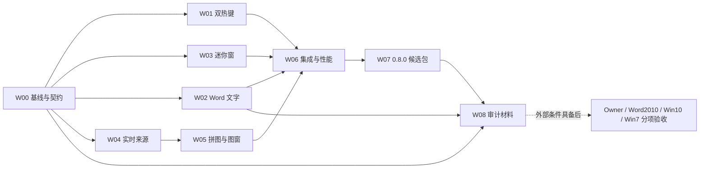

# AITSnap 0.8.0：0.7.2 基线审计、M3 差距与下一轮路线

编制日期：2026-11-01。状态：**PLAN_READY / NOT_STARTED**。本轮只核对源码与既有证据、编写计划；不修改产品、不安装、不宣称新增功能已完成。执行清单见 [DEVELOPMENT-CHECKLIST.md](DEVELOPMENT-CHECKLIST.md)。

## 1. 结论与范围

0.7.2 已解决安装完成后首次启动白屏和截图动作语义分散的问题，当前 Win11 安装闭环有 Owner 反馈及现场复核。原 M3 的现代 Word 软件链路已有真实执行证据；距离“全部完成”的主要缺口是人工报告验收和 Word2010 原生资格，而不是重新开发 Word 追加功能。

下一轮版本目标为 **0.8.0**，明确包含四项改进：每个截图动作的双热键、可配置/可关闭的 Word 文字、迷你截图窗、源区域及拼图的实时预览与独立图窗。Word 可配置文字在既有架构中已有设计目标，但产品设置尚未落实，本轮补齐；其余扩展也纳入本轮明确范围。原 M3 基础追加/恢复链路的既有证据继续保留。

采用两个独立交付结论：

- **现代版 0.8.0 候选交付**：当前可用 Win11 环境内完成开发、针对性验证、安装候选及体验审计材料；Win10 实机资格仍单列。
- **原 M3/完整平台验收**：软件证据、Owner 人工验收、Word2010、Win10/Win7 分别记录。没有目标环境时保留 HOLD，继续独立工作；不得将 Win11 或 Qt5 宿主测试改写为原生目标 PASS。

原定义中，M3 是 D04 的 Word 追加/排序/恢复/防重复；Win10 离线部署和 Win7 完整资格主要属于 D07/M5、L00–L02。此前“推进到 M3 并提供 Win10 安装包”的请求增加了交付要求，没有把这些验收层合成一个状态。

## 2. 基线及证据优先级

| 项目 | 本次核对结果 |
| --- | --- |
| 当前本地 main | `118246e8b8bc1f5949ce3b3ba3a9ae18683761e8`，工作树核对时干净，仅一个工作树 |
| 0.7.2 产品/候选源码 | `ec82339c78304e67e5d8b3b5937134608ba39972`（PR37）；与当前 HEAD 的 src/tests/tools/installer/CMake/translations/resources 无差异 |
| 安装与启动 | 最新 0.7.2 回执记载 Win11 安装、125 项 payload 匹配、完成页首次启动及同进程托盘恢复通过；本轮未重复安装/桌面验证 |
| Word 基础 | 异步独立 helper、精确文档绑定、持久队列、同文档顺序、提交标记、防重复恢复、按日自动目标及手动目标均已有实现 |
| 旧软件修正 | 0.7.1 拼图保存生命周期修正、对象管理/批量操作、面板修正沿用；0.7.2 三种截图动作共用命令入口 |
| 原累计预算快照 | `out/AITSNAP-V1-GOAL-TRAIN-001/ledger.json`：已用 `55874.473764s`（15.5207h），余 `376125.526236s`（104.4793h），`active=false`，当前条目 `072-W04=PASS` |

以上是本地源码与已落盘证据核对；本轮没有重新 fetch 来认证远端状态，也未重做历史运行测试。开发恢复前须重新核对远端、工作树及安装状态。

**恢复注意：ledger 中 milestones/holds/latestKnownProductStatus/finalPackage 等部分汇总仍指向 0.6.2。** `goals[072-W04]`、0.7.2 阶段回执和机器回执较新。不能因为旧汇总写着 launch-now FAIL 而重新认定 0.7.2 启动失败；也不能因为新安装 PASS 而清除 Win10/Win7/Word2010 的 HOLD。下一轮 W00 要保留历史，追加当前汇总及其来源，不改写旧失败记录。

使用下列材料解释状态，发生冲突时核对确切源码、包及原始结果，不只比较文档日期：

1. [0.7.2 安装交付回执](../AITSNAP-V072-REPAIR-001/DELIVERY-RECEIPT.md)、[执行记录](../AITSNAP-V072-REPAIR-001/EXECUTION.md)和本地 `out/AITSnap-0.7.2-EXECUTION-RECEIPT.json`。
2. [M3 后续原生 Word 验证](../../docs/architecture/M3-WIN10-CONTINUATION-RECEIPT.md)、[0.6.0 包内验证](../../docs/architecture/M3-INSTALLER-CANDIDATE-0.6.0.md)、[0.7.1 回执](../AITSNAP-V071-REPAIR-001/DELIVERY-RECEIPT.md)。它们补充早期 D04 回执，不被“较早版本”字样自动作废；若相关源码变化，新版需增量验证。
3. [原验收矩阵](../../docs/requirements/ACCEPTANCE-MATRIX.md)、[里程碑定义](../AITSNAP-V1-GOAL-TRAIN-001/ACCEPTANCE.md)、[人工审计包](../../docs/preview/OWNER-REVIEW.md)决定通过标准。

## 3. 距离 M3 与完整交付还剩什么

### 3.1 已有能力及不能重复列为欠账的项目

- Word16 真实追加、重开、图片内嵌/图注顺序、inline/table、COMMITTED 重放不重复、PREPARED 保留 UNCERTAIN 已有证据。
- 后续 M3 验证已覆盖大报告：公开 510 页夹具，首次插入后 Word 实测 512 页；512 是中间页数，不冒充最终分页数。明确目标文档在另一文档活动时追加、受保护和未保存目标拒绝、来源不变亦已验证。
- 同文档失败前驱阻塞后继、其他文档可继续；确认在修改文档前失败的任务可显式重试；UNCERTAIN 不能盲目重试。
- 0.7.1 包内现代 Word 创建→程序重启→继续追加通过。0.7.2 Word 实现未变，相关历史证据可以标注沿用。额外 0.7.2 包内 Word 探针被自动审批拒绝、未创建进程，应记 NOT_RUN，不能伪装为通过，也不能推导为产品失败。

### 3.2 差距、依赖与退出条件

| ID | 剩余项目 | 可继续推进的部分 | 当前门禁 / 退出证据 |
| --- | --- | --- | --- |
| M3-A | 人工 Word 报告验收 | 准备合成文档、逐步审计单、图片与文字预期；开发文字配置及回归 | **OWNER_HOLD**：人工查看打开文档、图注/页边距/表格、重开、失败恢复；记录确切版本及结果。此前“窗口正常”仅关闭启动问题，不等于 M3 全面签收 |
| M3-B | 新版 Word 定制功能包内集成 | 模板解析、任务快照、无文字布局、queue/helper 测试及安装候选均可做 | 新版改变 Word 写入行为后，须真实现代 Word 创建/追加/重开证明；若工具仍拒绝调用，最小范围 TOOL_POLICY_HOLD，不绕过旧拒绝换入口 |
| M3-C | Word2010 原生资格 | 可准备同一组合成案例与结果采集格式 | **ENV_HOLD_WORD2010**：有授权、可用的 Word2010 环境，记录 OS/Office/应用位数；覆盖追加/表格/长报告/忙碌/恢复及新文字模式。Word16 结果不能替代 |
| M1/M2-A | 截图、框选与拼图人工体验 | 可继续修正真实缺陷、准备双热键/迷你窗/实时预览演示 | **OWNER_HOLD**：物理键、托盘、鼠标编辑、混合 DPI/断连/恢复及视觉审计；单次 agent 输入检查不等于全面人工签收 |
| D07-A | 性能/稳定性与包回归 | 可在当前主机测量新功能开关、资源、正式截图影响及升级；旧数据只作对照 | **可推进**；2×4K 等不存在的实际拓扑单列 HARDWARE_HOLD，24h 观察或有理由的缩减证据仍属 M5，不能用短测试替代却不说明 |
| D07-B | Win10 x64 目标安装与运行 | 可生成离线包、依赖清单、校验/升级测试脚本 | **ENV_HOLD_WIN10**：用户已确认暂无目标。需实际目标机/授权 VM 完成安装→首次启动→托盘→截图→升级/卸载及数据保留。Win11 开发机安装不关闭该项 |
| L00–L02 | 原生 Win7 SP1 x64 与 x86、Word2010 与完整链路 | 维持 Qt5 共享源码兼容构建，准备测试材料 | **ENV_HOLD_WIN7**：合格 v142/SDK/CRT/Qt5 工具链和获授权目标均须具备；此前 MSB8020、VM 枚举拒绝仍保留。WOW64 不等于原生 x86 OS |
| M5-A | 全平台正式发布资格 | 可整理许可证、包来源、平台支持说明及完整回执 | **RELEASE_HOLD**：依赖上述目标资格和 Owner 签收；本轮不能把现代候选包描述为完整 Win7/10/11 合格发布 |

**因此不是“还需重写多少个模块才能 M3”：现代基础链路已具备，M3 人工闭环与 Word2010 资格仍开着；0.8.0 的四项新功能可以独立向前推进。** Win7 与 Win10 缺失不阻塞双热键、Word 模板纯逻辑、迷你窗或现代主机实时预览开发。

## 4. 0.8.0 功能设计

### F01：每个截图动作同时支持两套热键

现状：`Settings` 只有 `saveHotkey/copyHotkey/bothHotkey` 三个字符串；解析器已接受部分无修饰键输入，缺的是第二绑定槽和显式动作映射。不能仅扩成六个字符串后继续用热键编号减偏移当作动作编号。

| 动作 | 主绑定（迁移保留） | 备用绑定（可同时启用） | 动作内涵 |
| --- | --- | --- | --- |
| 截图并保存 | 现有值；新用户 Ctrl+Alt+S | 默认空，可设单键或另一组合键 | 新采集、保存；启用报告时按规则入队 |
| 截图并复制 | 现有值；新用户 Ctrl+Alt+C | 默认空，可设单键或另一组合键 | 新采集、只复制选定输出；不落盘、不写 Word |
| 截图、保存并复制 | 现有值；新用户 Ctrl+Alt+A | 默认空，可设单键或另一组合键 | 一次新采集、保存及复制；按报告开关入队 |

设计为三个动作各两个可选槽，最多六个绑定同时生效，不是“两种方案只能选一种”。设置提供录入/清除、实际注册结果、动作级冲突定位；允许备用槽空置，但三个动作应保留至少一个绑定，除非用户明确关闭该动作的热键。按钮/托盘/迷你窗仍可用。

允许用户选单字母/数字等解析器支持的单键；说明全局单键可能影响其他应用输入，不预设占用字母键。优先示例用非保留功能键；设置显示“备用单键启用”开关，暂停截图时全部注销。录入热键时暂停实际截图，退出后按原暂停状态恢复。F12 为系统调试保留键应明确拒绝，系统占用及 PrintScreen 冲突反馈真实注册结果，不承诺抢占成功。[Microsoft RegisterHotKey 文档](https://learn.microsoft.com/en-us/windows/win32/api/winuser/nf-winuser-registerhotkey)

规范化比较所有绑定：同动作重复可合并为一次注册，跨动作相同则拒绝并指出双方。改配置失败时恢复旧绑定；恢复也失败时明确显示哪个动作不可用。长按不连发；UI 提示、托盘菜单及设置显示两套真实绑定。旧配置自动进入主槽，备用槽空，版本迁移保留原文件。

### F02：Word 文字模板与“只写图片”

现状：`makeReportJob()` 固定生成批次标题及“区域/场景名称 | 时间”图注，helper 无条件插入对应段落。将字符串设空仍可能产生空白段落，不等于真正关闭文字。

在“批次与报告 → Word 写入设置”提供：

- 批次标题：开关 + 模板；图片说明/图注：开关 + 模板；上下文信息：开关 + 模板，均可独立关闭。
- 一键“只写图片”：关闭全部可见标题、说明和上下文文字；允许图片排版必需的段落/表格结构，不能额外留下文字专用空段落。
- 使用真实字段的样例预览，不需要启动 Word。支持固定字符串、多行中文和有限字段占位符；未知字段应指出位置，缺失上下文字段按约定显示空值，不输出硬编码的 `test= device=...` 空串列。
- 默认迁移保留 0.7.2 原有可见内容；同时提供“仅名称”“名称与时间”“自定义”“只写图片”预设，不默默改变已有报告习惯。

建议字段：批次级 `{profile}`、`{datetime}`、`{sequence}`、`{test}`、`{device}`、`{station}`、`{operator}`、`{run}`、`{step}`、`{command}`、`{event}`；图片级另有 `{name}`、`{number}`、`{kind}`、`{scene_revision}`。具体映射及时间格式在 W02 冻结，文档与预览一致。固定字符串无需占位符。花括号转义给出清晰示例，不执行脚本或 Word 宏。

模板必须从该次捕获的配置、名称和上下文快照求值；已创建任务冻结解析后文字及开关，重试/重启不根据当前设置重新生成。旧 v1 任务及其指纹保持可读、保持原语义；如新增行为字段超出现有指纹范围，采用明确的版本分支或兼容规范。隐藏提交标记和来源哈希继续保留，“不写文字”只关闭可见内容。

既有按日自动 Word 路由和明确目标路径保持；报告关闭或纯复制时不会因模板功能产生 Word 文件/任务。现代 Word 实测与 Word2010 实测分别记账。

### F03：迷你截图窗

用途：配置完毕后，操作者用鼠标即可完成原有截图动作。迷你窗与主窗共享状态和命令，不另建截图流程。

- 默认一个醒目的“截图并保存”主按钮，旁边显示当前配置名称、忙碌/完成/失败；下拉可选另两种已有动作并记住选择。启动迷你模式不触发截图。
- 按钮真实含义与 F01 三动作表一致；不新增含糊的“仅截图但不知道结果在哪里”第四动作，也不把 UI 图片复制当作新采集。
- 支持拖动、可选置顶、位置记忆、主窗切回、暂停和托盘菜单；关闭迷你窗返回托盘，不等于退出程序。入口在主窗和托盘。
- 点击只提交一次；忙碌时防止重复触发，状态提示不抢其他应用焦点。显示器布局变化时把窗放回可见工作区。
- 正式截图前处理自身遮挡：隐藏并等待画面更新，或使用已证实有效的捕获排除能力；失败不能保存一张遮住源区域的图却报告成功。
- 浅色/深色/系统模式及中文/英文沿用全局外观，不再做独立主题系统。

### F04：实时源预览、实时拼图与独立图窗

现状和原因：工作台/源卡片从 `lastOutcome_ → batchSources()` 读取最近批次；场景缩略图复用这些来源并以 placeholder 处理缺源。未截图时没有该批次的像素，因此显示纯色和 MISSING。这是“查看最近截图”的当前实现，用户期待的实时工作区尚未实现，不是显示器本身没有图像。

本轮对“实时透传”的规划含义：**持续看到所选屏幕区域的当前像素、实时组合预览，并可把区域或场景独立开成图窗**。这是本计划的设计假设；鼠标点击穿透、窗口透明度、远程串流、虚拟摄像头属于不同能力，不并入必交范围。若用户后续明确需要鼠标穿透，再追加开关及恢复交互方案。

工作区增加“实时预览 / 最近截图”明确切换；实时预览可在首次进入该工作区时按已保存偏好开启，提供可见暂停开关，隐藏后停止无订阅采集。没有历史截图也能看当前有效来源，不要求先保存一次。

实现分三层复用现有控件和算法：

1. **LivePreviewService**：复用显示器枚举/GDI 采集与裁切能力，独立于产生证据批次的 CaptureService；共享有界采集调度，避免正式截图与预览争抢资源。后台采集后通过不可变帧交付 GUI，GUI 线程操作 Qt 控件。
2. **实时工作区**：显示器布局内区域、源卡片及拼图编辑器采用同一帧集合；复用现有图像预览、场景变换/裁剪/比例算法。预览图与编号/标题分层绘制，文字不随位图拉伸变虚。
3. **独立图窗**：选择单个区域或拼图场景开窗，尺寸/比例可调、可选置顶、暂停/恢复、返回主窗。实时帧不进入“历史批次”；历史浏览始终读冻结证据。

正式截图仍走 0.7.2 命令与新采集流程，不从不确定年龄的预览缓存取证。实时刷新**不创建 batch、不增加 sequence、不保存图片、不排 Word、不写截图历史**。实时图窗中的“截图”入口若提供，也调用同一正式命令。

性能设计：先以 2fps 作为初始工程参数，提供受限刷新档；这不是已达到的性能承诺。只订阅可见工作区/打开图窗所需来源；每屏一轮采集后复用裁切，队列只保留最新帧，缩略预览按显示尺寸降采样，设置合理像素与内存上限。关闭/隐藏后释放订阅；配置切换带 generation，旧结果不得覆盖新区域。正式截图优先、预览可丢帧。最终刷新档依据 W06 实测确定。

必须有状态和时间：实时、最近截图、未采集、暂停、过期/失败。锁屏、断屏、改布局或失败时不得把上一帧标成仍在实时更新；显示具体状态。跨屏帧不是硬件同步，记录采集跨度，不宣传同时曝光。

**自采集递归是必须解决的验收项。** 微软说明 `WDA_EXCLUDEFROMCAPTURE` 从 Win10 2004 引入，早期系统会按 `WDA_MONITOR` 处理；后者可能是空白而非显示下层内容，且有 DWM/捕获路径边界。不能承诺 Win10 1809 或 Win7 与新系统有同样效果，须实测当前 GDI 路径。[Microsoft SetWindowDisplayAffinity 文档](https://learn.microsoft.com/en-us/windows/win32/api/winuser/nf-winuser-setwindowdisplayaffinity)

W04 先验证自窗口排除、重叠区域和资源回收；若无法在某目标路径正确透出下层内容，则明确限制把实时图窗放在被采集区域外，或暂停该重叠预览并提示移动。不得用持续“隐藏→显示”闪烁伪装高质量实时效果，也不得把黑块当成功图像。正式截图可用受控的临时隐藏策略，需单独验证。

## 5. 开发路线、依赖与时间分配

下表是**建议执行上限**，不是已经批准的新计时额度或完成时间保证。全部仍受原 120h 累计硬上限约束；未来按实际消耗继续记账，不重置计时。单叶任务不超过 8h，一个连续开发段不超过 12h；本计划合计 44h，其余预算不自动分配给额外需求。

| 顺序 / Goal | 上限 | 前置 | 可审阅交付及退出条件 |
| --- | ---: | --- | --- |
| W00 基线与恢复整理 | 2h | 重新接纳 main/工作树/预算 | 修复账本当前汇总指向，冻结迁移/动作/预览状态约定；历史回执不改写 |
| W01 双热键 | 5h | W00 | 六槽到三动作映射、设置 UI/迁移/冲突回退；两槽分别触发相同副作用 |
| W03 迷你窗 | 5h | W00，共享既有动作 | 尽快提供鼠标截图体验；状态/托盘/主题/DPI/自身遮挡检查 |
| W02 Word 文字配置 | 6h | W00 | 模板/开关/示例预览、任务冻结及兼容指纹；真实现代 Word 测试能执行则执行，缺证据只 HOLD 此验收 |
| W04 实时来源服务 | 8h | W00 | 后台采集、订阅/暂停/限流/状态，先证明没有文件/序号/Word 副作用及递归问题处置 |
| W05 实时拼图与图窗 | 6h | W04 | 复用同一帧集/场景模型，工作区/编辑器/独立窗；历史模式不混入实时帧 |
| W06 集成与性能 | 6h | W01/W02/W03/W05 软件部分 | Qt6/Qt5 受影响目标、正式截图优先、资源及多屏实测；为新功能生成验收材料 |
| W07 0.8.0 候选包 | 4h | W06 软件退出，验证 HOLD 明列 | 干净源码版本/哈希、setup/MSI/ZIP、0.7.2 升级与首次启动、配置保留；Win10/Win7 资格继续分列 |
| W08 M3/平台审计包 | 2h | W00 可先起草，W02/W07 填版本 | 人工 Word/原生目标步骤、预期与实得、最终 OPEN/HOLD/PASS；不能预填签收 |
| 合计 | **44h** | 原预算快照余 104.4793h | 环境缺失不阻塞独立软件功能；存在真实失败则修正或如实 PARTIAL |

推荐连续段：W00+W07（分次合计6h）；W01+W03（10h）；W02+W08（8h）；W04（8h）；W05+W06（12h）。编号用于稳定追踪，不强制按数字顺序；W03 放在 Word/实时之前，先交付便于手动体验的迷你截图。

各分支可在依赖满足时顺次自主推进；此图不是并发写入或启动子代理的授权。新增 Word 行为未取得真实 Word 证明时，可以完成其他功能并产出诚实标注的候选包，但不能给它 Word 全验收 PASS。

## 6. 改动边界与复用

| 范围 | 现有入口 / 复用点 | 必须保留 |
| --- | --- | --- |
| 热键 | `src/adapters/hotkeys.*`、`json_store.*`、`src/main_window.cpp`、`src/desktop/workspace_ui.cpp` | 原自定义绑定、暂停、注册回退、三动作语义 |
| 报告 | `src/adapters/report_queue.*`、`word_bridge_main.cpp`、报告设置 UI | 按日路由、精确目标、旧任务指纹、同文档 FIFO/UNCERTAIN/提交标记 |
| 迷你窗 | 新增小型 desktop 组件，复用主窗 QAction/状态/外观 | 不复制 capture pipeline、不改变关闭到托盘约定 |
| 实时预览 | `win_capture.*`、`scene_render.*`、`workspace_browser.cpp`、`workspace_views.*`、`scene_editor.cpp` | 原图不变、变换/裁剪/比例一致、文字图层分离、历史确定性 |
| 配置 | 当前 settings schemaVersion=4，旧格式读入/备份迁移 | 明确新增版本和默认值；旧格式字段/未知扩展按既有策略处理，不静默抹掉旧自定义 |
| 包与测试 | 现有打包工具、report/settings/scene/desktop 集成测试 | 源码→包→安装文件绑定；只跑受影响检查；无变化文档不跑全 CI |

不为本轮新增远程服务、插件系统、录屏编码器、通用模板脚本引擎或重写 UI 技术栈。现有控件可满足时复用，只有实时帧交付/迷你窗等确需新增的职责单独建模块。

## 7. 接手执行与停止规则

1. 从本文件和清单恢复；检查工作树、最新远端、原账本及实际安装版本，保留已有未提交内容。使用 `codex/` 分支或隔离工作树，不盲 pull/reset/clean。
2. 本计划没有启动 0.8.0 开发。本轮规划耗时与上列预算快照不是新增 allowance；实际恢复时核对会话/账本计费并沿用总账，禁止凭估算制造已执行时长。
3. 每个 Goal 记录状态、源码 SHA、测试调用/结果/复用范围、NOT_RUN/HOLD 原因、PR/合并 SHA、实际用时、累计余量和下一可推进 Goal；连续段内含等待/修正也计费。
4. 按既有授权和分支保护完成定向测试、diff 审阅及 PR；同会话审阅不冒充独立只读审查。无需因为未变的旧代码重复全量 CI。
5. Computer Use 对 msiexec 的拒绝及先前 Word 探针自动审批拒绝保持有效；需要的验收由允许的渠道/Owner 接续完成，不换包装或入口绕过。不能完成的仅给最小验收项 HOLD。
6. 达到原累计120h、叶任务上限且不能安全收敛、没有安全可推进项或遇明确授权边界时，保留代码和回执后停止；输出已合并 PR、实际候选包、功能与 M1–M5 状态及每个剩余阻断。任何缺失签收均保持 OPEN/HOLD。

## 8. 下一轮完成标准

0.8.0 的四项需求都有明确实现和对应证明；旧配置/旧任务可以恢复；正式截图的文件、序号、剪贴板和 Word 副作用保持一致；包能在已验证主机安装和启动。实时预览的限制、默认刷新策略和缺失平台测试清楚可见。

M3 现代软件交付、M3 人工签收、Word2010 原生资格、Win10 原生部署与 Win7/L02 资格分别给状态。允许交付带清晰 HOLD 的现代候选，不允许将“0.8.0 已打包”写成“M3/M5 全平台已完成”。
