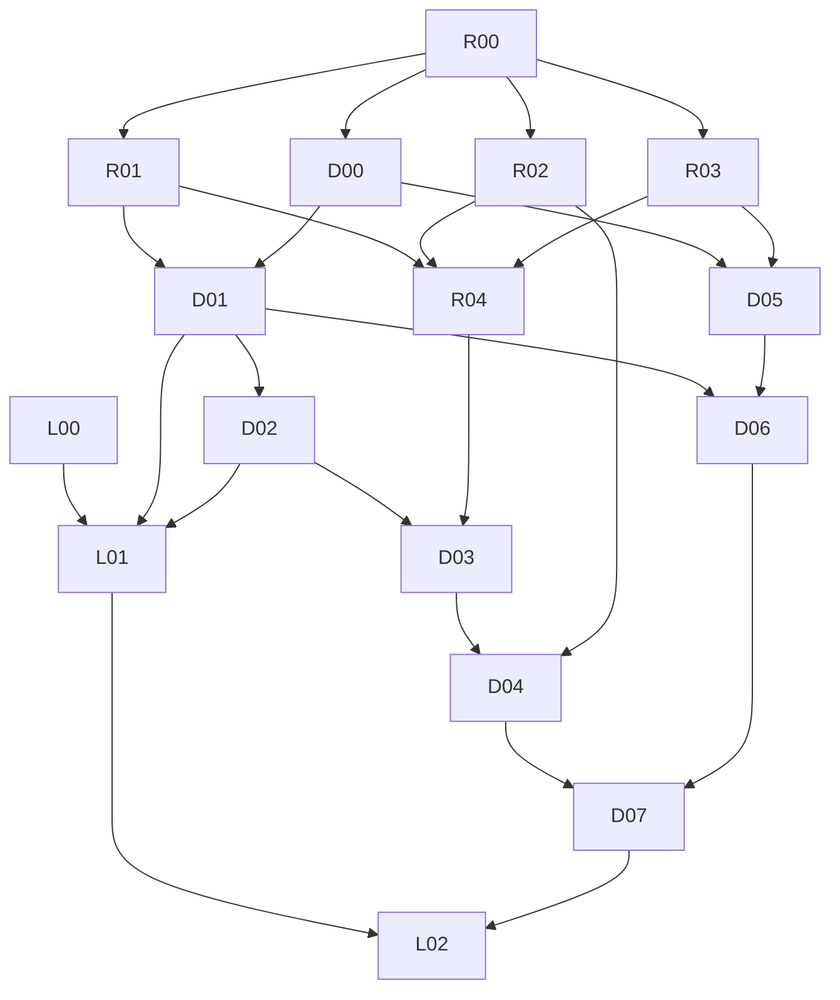

# Dependency DAG

Each edge means required source contract or evidence from predecessor, not an implied release approval. If a dependency has missing real hardware/Office, permit independent pure-core work and record the relevant HOLD. No cycles by design.
