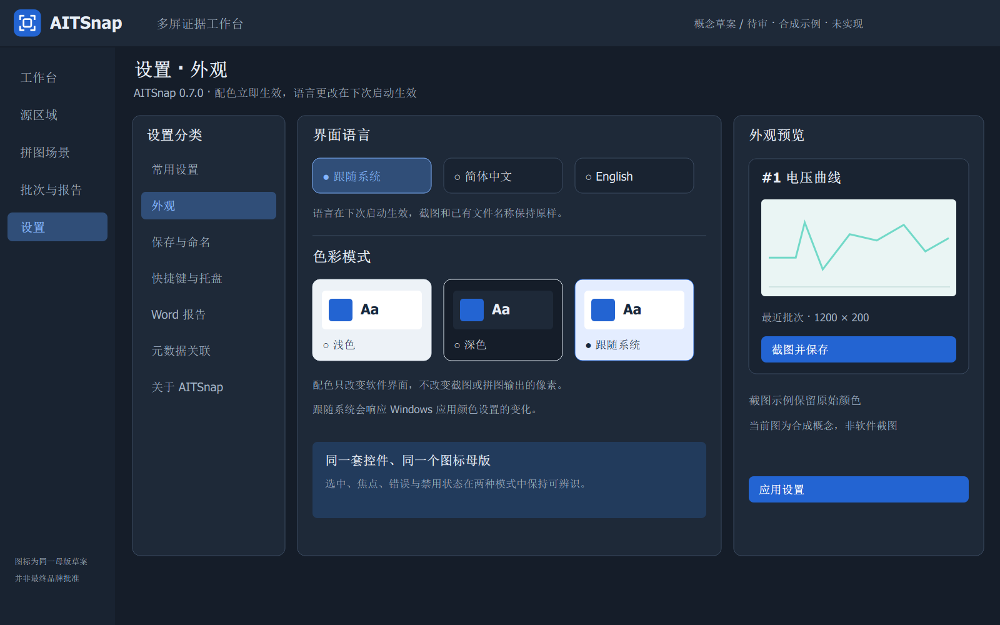

# 0.7.0 外观与多语言

Owner 已授权 Codex 继续开发并固定目标为 0.7.0。本轮新增“设置 → 外观”：简体中文、English、跟随系统语言，以及浅色、深色、跟随系统配色。配色即时预览，点击应用配置后持久保存；语言重启生效。界面控件采用统一主题，截图原像素、历史证据和拼图输出背景不随主题更改。

代码已接入以上能力，设置 schema 升为 4，读取旧版 1–3；首次保存前精确保留旧文件。N07 已将这些控件整合到完整设置分类，含外观子页，详见 `docs/architecture/UX070-WORKSPACE.md`。本文件不是最终 0.7.0 安装候选验收回执。

## 可审计概念

[浅/深色切换面板](concepts/appearance-review-board.html) 包含工作台、源区域两页、拼图、批次报告、常用设置及新增外观页；原有九张图各补一张深色 PNG/SVG，新外观页提供两种模式。全部是合成示例，不是运行截图或 Owner 验收证据。

生成：运行 `generate_appearance_concepts.py`，再使用可选的 `aitsnap-render-assets` 工具渲染 SVG。工具构建选项 `AITSNAP_BUILD_ASSET_TOOLS=ON`，使用已有 Qt Svg；仅用于资产制作，不打入产品。PNG 须使用 Windows 字体后端，offscreen 后端在本机曾出现缺字方框，该失败导出已替换并重新视觉检查。

## 第一轮针对性验证

- Qt6 x64：appearance、desktop-adapters、scene 通过；Qt5 x64：appearance、scene 通过（Win11 host，不是 Win7 资格）。
- `tests/appearance_tests.cpp`：实际按钮英文、浅深色对比、设置重载、旧配置原字节备份、删号不复用、源图/导出像素独立、标签变换独立。
- `tests/localization_tests.py`：已迁移 UI 字符串的英文覆盖及 Qt 参数占位符一致。
- 文件命名的 UUID 移除与冲突回归、整体浏览页面和安装完成链路仍在后续工作包中推进；以 EXECUTION-070.md 更新为准。

实际 Win10、Win7、Word2010、Owner 最终视觉批准仍为 HOLD，不由上述组件测试替代。
