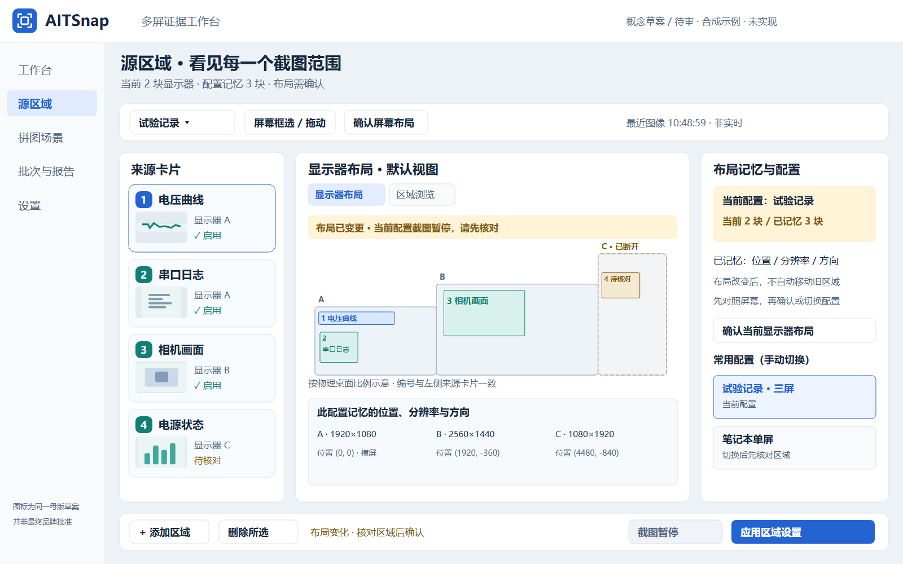

# 显示器布局默认页与记忆能力核对

Owner 新要求：源区域的子页签顺序改为 **显示器布局 → 区域浏览**，进入源区域默认显示前者。概念图及离线审计面板已按此调整；**尚未修改运行中的产品**。

## 新草图

整体以显示器的相对位置、横竖方向和区域分布为主，保持左侧源卡片和右侧属性/配置结构。每块屏幕和每个区域均可识别，进入页面先回答“现在连着几块屏、各区域在哪”；第二页再看所选区域的实际图像。

右侧“常用配置”表示**手动切换配置**的概念入口，不是已有自动场景识别能力。图中三屏/单屏配置为合成示例，不代表用户当前真实配置。

增加一张插拔变化状态供审计：断开的屏幕以虚线示意，相关区域标记待核对，显示当前与记忆数量差异。现有核心在布局不匹配时会阻断**该配置的全部区域截图**；图中截图暂停对应这一现有约束，不能推断软件已支持“其余区域自动继续”。

## 当前软件究竟记不记布局？

结论：**有按截图配置持久保存布局基线和比对的功能；没有完整的多环境自动识别/自动恢复机制。** 以下是基于产品基线 `b9fad25d20fb2325b584411acc27e7c5e1534601` 的源码核对，未做现场拔插、旋转或DPI切换验收。

| 能力 | 当前事实 | 源码 |
| --- | --- | --- |
| 保存布局 | 每个CaptureProfile保存calibratedDisplays；序列化id、rect、rotation，重新读取可恢复这些字段 | `src/core/domain.h:15–20`；`src/adapters/json_store.cpp:37–65` |
| 保存区域 | 区域名称、身份、绝对桌面物理像素矩形和启用状态随配置保存 | 同上 |
| 检测布局变化 | sameTopology先按显示器id排序，再比较数量、id、矩形和旋转；不是比较枚举顺序 | `src/core/domain.cpp:71–78` |
| 发生变化后的行为 | 下一次捕获发现不一致时返回TOPOLOGY_CHANGED，不抓取此配置的区域 | `src/core/capture_service.cpp:16–32` |
| 手动确认 | “确认屏幕布局”更新当前配置的显示器快照并保存；**不会自动重映射原有区域坐标**，界面要求先核对区域 | `src/main_window.cpp:192–198` |
| 多配置 | 已支持新建/选择截图配置；可以人为准备办公室、笔记本等不同配置并手动切换 | `src/main_window.cpp` 的profiles及新建配置逻辑 |
| 即时热插拔提示 | 本次检索未找到WM_DISPLAYCHANGE或完整Qt屏幕变化订阅；现有明确检查点在截图时 | `src` 检索与CaptureService |
| 常用布局自动识别 | 未发现命名布局库、布局到截图配置自动匹配或恢复的完整实现 | 配置schema/Settings/CaptureProfile与现有UI |
| 稳定硬件身份 | 当前ID由Windows显示设备名称和DeviceID拼接，不能承诺换端口/扩展坞后稳定不变 | `src/adapters/win_capture.cpp:58–68` 附近 |
| DPI/缩放记忆 | Display模型只保存id、rect、rotation，不含独立DPI/缩放值；不能把分辨率相同视为DPI未变 | `src/core/domain.h:15` |

本轮只读核对默认应用配置文件，观察到1个配置内保存了4个显示器矩形。没有复制完整真实配置到交接包，也没有输出硬件ID、修改配置或切换显示器；计数只证明本机确有保存数据，不证明热插拔自动恢复。

## 对经常变动显示器的用户，下一轮怎么补？

### 第一阶段：复用现有配置与比对，先把状态讲清

- 进入源区域默认显示器布局；区域浏览在第二位。审计面板每次从主导航进入源区域都恢复该默认视图，不是切回上一次区域浏览。
- 对照当前桌面与当前配置快照；订阅Qt/Windows屏幕数量、位置、模式等变化，去抖后更新界面，事件触发不等于保存新的布局。
- 显示“匹配/有变化/屏幕缺失/区域需核对”，提供手动切换已有配置和明确确认入口。
- 用户确认之前不覆盖旧快照，不因点击“确认布局”就暗示区域已经自动适配；定位、核对或重新框选依然需要正确完成。
- 继续沿用现有捕获时校验；额外拆分“仅阻断受影响区域”属于新的捕获策略，需要另外设计/测试。

### 第二阶段：常用环境识别与可审计恢复（当前尚无）

- 给常用环境命名，将布局特征与对应截图配置关联。已知布局回来时建议切换；是否自动切换由用户显式选择，不能默认静默更换截图对象。
- 使用更稳定的显示器身份信息与候选匹配；同型号、缺少序列号、换端口/扩展坞造成歧义时，让用户看见待匹配屏幕，不随意认作同一块。
- 单屏区域可以保存显示器内局部物理像素锚点，再根据当前显示器原点恢复。分辨率/旋转变化后重新校验边界。
- 当前支持跨屏区域，不能给所有区域强行套单显示器锚点；跨屏区域保留明确的复合布局约束或要求重确认，不静默裁切。
- DPI/逻辑像素和物理像素分开记录；不要用DPI比例直接缩放原始证据或把历史截图改成新布局。
- 原始截图/批次/场景引用/Word任务保持不变；新的布局适配影响后续捕获，不重写旧证据。

建议将第一阶段纳入N07/N08的源区域改造；第二阶段单列有界工作包，不能因为这张草图就宣称已开发完成。

## 针对性验收

1. 相同屏幕、位置、分辨率和旋转，保存并重启后仍匹配；单纯枚举顺序变化不应误报。
2. 拔掉/重新接回、笔记本仅内屏/扩展坞、多屏负坐标、主屏切换、横竖屏和分辨率变化分别验证。
3. 换端口及两台同型号屏幕测试身份歧义；DPI变化单独检查。合成单元测试不能替代真实组合。
4. 确认快照不会移动区域；选择已有环境恢复时有预览和明确映射结果，错配不得继续捕获错误对象。
5. 没有对应硬件时记录HOLD，不更改机器显示设置来伪造Owner实际使用场景。
