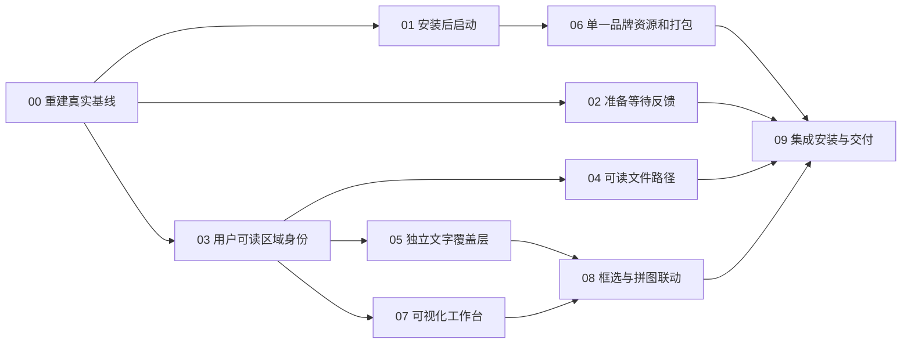

# 下一轮路线与可执行开发清单

目标：先恢复可靠安装体验，再让用户直观看清“哪些屏幕、哪些区域、生成哪些文件和拼图”。沿用 C++/Qt Widgets、现有捕获/场景/队列核心。不要为换皮重写采集、Word、事件管线。

范围：本轮是交接规划；下列复选框均为**未来工作**，不能用本轮文档提交把它们勾成已完成。预计净开发/针对性验证约 26 小时，计划窗口 26–36 小时；这是估算，不增加原始 120h 预算。每个工作包至多 6h，到界限保留部分成果、记录阻断后重新拆分，不能悄悄续期。

## 依赖与交付顺序

推荐先发布安装修复候选（暂称 0.6.3），通过之后推进 UX 版本（暂称 0.7.0）。版本名可调整，失败包保持不变；不把未验证包覆盖成同名“已修复包”。

| 工作包 | 优先级 | 估算 / 上限 | 主要成果 | 依赖 |
| --- | --- | --- | --- | --- |
| N00 | P0 | 1h / 2h | 精确基线、日志及现有配置副本 | 无 |
| N01 | P0 | 3h / 4h | 完成页启动闭环 | N00 |
| N02 | P0 | 2h / 3h | 准备阶段可见反馈、分段耗时 | N00 |
| N03 | P1 | 3h / 4h | UUID/编号/名称分离及兼容迁移 | N00 |
| N04 | P1 | 2h / 3h | 文件夹、原图、JPEG、拼图可读命名 | N03 |
| N05 | P1 | 2h / 3h | 独立身份标签与可选题注 | N03 |
| N06 | P1 | 3h / 4h | 一份母版、多尺寸、系统入口资源 | N01；品牌样式待审 |
| N07 | P1 | 4h / 6h | 多屏来源与输出工作台 | N03；概念布局待审 |
| N08 | P1 | 3h / 4h | 框选/拼图编号联动、源状态可见 | N05、N07 |
| N09 | P1 | 3h / 4h | 原生安装、升级、可体验候选和回执 | 前述工作包 |

## N00 — 基线和最小复现

责任范围：测试证据、现有安装/配置快照，不更改真实用户数据。

- [ ] 核对 worktree、HEAD、锁、远端和当前进程；保留 Owner 正在使用的应用。
- [ ] 读取本交接全部 5 份 MD、历史0.6.2回执、最新诊断摘要；承认旧“完整安装流程 HOLD”已细化为“路径 PASS、部署 PASS、启动 FAIL”。
- [ ] 从注册/清单发现真实安装目录、包SHA、EXE版本、Qt模块路径与数据目录，不让 Owner 填路径参数。
- [ ] 保留最新原生日志及其SHA，生成脱敏时间线。现有样本中还原点20.236s；不要重复无意义安装来证明已知事实。
- [ ] 用独立配置/合成图片建立最小复现；真实配置只读复制，禁止重写源图或旧Word job。

验收：存在可恢复的基线记录及明确失败信号；不是仅凭静态断言通过。

## N01 — 立即启动可靠性

责任文件：`tools/msi_ui.py`、`tools/build_msi.py`、`tests/msi_wizard_tests.py`；只有确认应用启动分支有缺陷时才改 `src/main.cpp`/`src/main_window.cpp`。

- [ ] 记录完成按钮点击→属性值→事件发布→文件解析→进程创建/退出→可见窗口的实际链路。
- [ ] 针对 INS-01 的排序假设逐项证伪；先验证 final-MSI 中 File key、引号/参数语义和复选框真实值，不直接用 PowerShell脚本替代启动来“变绿”。
- [ ] 先写能击中真实失败模式的回归；静态表检查继续保留，但它不能证明进程/窗口。
- [ ] 修复后验证英文、空格及中文安装路径；至少新装、升级两种场景。
- [ ] 已运行时应唤回现有主窗口或给出明确提示；托盘启动选项与“立即启动”意图要一致。
- [ ] 失败提示包含可操作原因/日志入口；安装事务成功与应用启动失败分开表述，不能假报安装回滚。
- [ ] 未勾选、静默、失败、取消、卸载不自动打开应用；启动不能抬高为管理员或更换用户上下文。

验收：准确版本及路径的进程、可见窗口、源自 Finish 的关联证据都存在。Computer Use 继续拒绝时，代码和非UI证据可推进，原生可见交互仍需真实人工或合规可用工具，不能绕过限制。

## N02 — 立即反馈与安装耗时

责任文件：安装UI/序列、窄范围诊断脚本；不要更改机器系统保护策略。

- [ ] 点击“安装”后，先禁用重复提交并显示可见准备状态；正常负载目标≤500ms，实测记录首帧而非只记 ProgressDlg action。
- [ ] 覆盖服务准备/还原点等待，显示持续忙碌状态及“正在准备安装，可能需要片刻”；3s以上不能只留下静止白页。
- [ ] 有真实 SetProgress 后再转为可度量进度；阶段切换不伪造0–100%、剩余秒数或失败原因。
- [ ] 解释/验证 modeless生命周期、重绘、ActionText订阅和取消行为；不能盲改 KeepModeless。
- [ ] 对新装、升级、修复分别采集分段时间；冷/热状态及是否还原点分开记录。仅针对变化重测，不跑重复全量CI。
- [ ] 总耗时不承诺固定阈值；已知20.236s属于当前系统还原点调用，改善“无反馈”与减少实际耗时分开验收。

验收：等待期间有可见、持续反馈；提交→首帧、服务准备、旧版本卸载、文件部署、完成页分别有时间证据。禁止以关闭系统还原/防护获得指标。

## N03 — 区域编号与名称

责任文件：`src/core/domain.*`、`src/adapters/json_store.*`、配置/schema、`region_editor.*`、`scene_editor.*`、`main_window.*`。

- [ ] 定义UI身份对象：内部UUID、配置内稳定displayNumber、可编辑name；预览和文件名从同一适配层取得标签。
- [ ] 迁移原配置时按原顺序分配号码，备份原字节；旧schema保持可读，引用UUID不变。
- [ ] 推荐删除不重编号、号码不复用；新区域取下一个号码。若Owner选择连续排序，只改变显示序号及快照，不改变内部身份。
- [ ] 所有正常UI显示 `#1 电压曲线`，包括框选、来源卡、图层卡、源选择、Clipboard和历史源提示。
- [ ] 屏幕边缘/小框/跨屏时标签钳制在可见区，号码和名称不被画布或工具栏遮挡；仅颜色不足以识别。
- [ ] 缺失源显示人类提示及保存的名称快照；UUID移至诊断详情，不作为默认标签回退。
- [ ] 同源多实例显示相同源号，图层副本追加“副本2”等实例名；禁止为副本重新编号成另一个截图源。

验收：改名、拖动、删除、重启、场景复制、历史批次均能稳定对应。迁移后已有Word任务、场景引用、来源哈希和幂等键不变。

## N04 — 文件和目录命名

责任文件：`capture_files.*`、`json_store.*`、批次元数据/读取与测试；不迁移旧文件。

- [ ] 集中实现可读命名器；统一覆盖批次目录、lossless originals、JPEG导出、composites-only证据、拼图名称。
- [ ] 默认名称见问题文档示例；默认可见路径不含内部UUID。用户显式的诊断导出是例外。
- [ ] `{region}`继续取实际名字，增加区域号/场景号的命名能力并给出保存前路径预览。
- [ ] Windows保留名、非法字符、尾点空格、中文、清洗后重名、长名、同毫秒批次及重复场景不能覆盖已有文件。
- [ ] 冲突以确定的短序号＋独占创建处理；不要退回UUID，也不要基于“先检查后覆盖”写法。
- [ ] batch.json保存身份及命名时快照；历史读取依据manifest路径，兼容旧UUID目录。
- [ ] 重命名当前区域仅影响未来批次；旧证据与排队Word sourceRefs保持原值。

验收：用户能从文件名辨认区域/拼图；原始证据仍lossless，SHA一致，历史批次和Word无回归。

## N05 — 图片、编辑器覆盖层和输出题注分离

责任文件：`scene_editor.*`、`scene_layer_item.h`，必要时新增小型overlay/text item；输出题注确有需求才扩展scene模型/schema和renderer。

- [ ] 移除占位QImage中软件自己绘制的身份文字；占位只表达区域比例和缺源状态背景。
- [ ] 编辑器标签在视图空间独立绘制，使用清晰文字而非放大位图；100%、50%、25%、200%缩放下可读。
- [ ] 标签、编号、句柄不受图片非等比缩放/旋转影响，并能正确命中和避开屏幕边缘。
- [ ] 截图原本包含的文字继续属于源图；不伪装成OCR或可编辑文字。
- [ ] 编辑器标签默认不进入导出；若启用输出标题，在最终画布分辨率单独排版绘制，源图不改变。
- [ ] 新增可编辑题注时，Word用段落/Caption保留文本语义；不要宣称PNG含矢量文字。

验收：变换前后源SHA不变；导出无编辑器手柄/编号污染；输出标题开/关有独立像素与版式证据。

## N06 — 单一品牌母版与系统入口

责任文件：拟新增 `assets/brand/`、`resources/`、应用 `.qrc/.rc`、CMake、MSI及打包工具。概念图中的标识只是待审草案。

- [ ] Owner审定一个SVG母版；记录许可和可复现派生脚本，禁止多个近似logo源。
- [ ] 派生多尺寸ICO/PNG，覆盖常见DPI；小图用同一几何适配，不换图案。
- [ ] Qt窗口/托盘、PE主EXE、开始菜单/可选桌面入口、卸载列表、向导都使用同源资源。
- [ ] 验证快捷方式Icon容器格式和升级缓存刷新；不能只看运行时QIcon截图。
- [ ] 若安装分发文件也必须有品牌图标，实现薄setup.exe主入口，嵌入同一MSI及同源ICO，记录双层哈希，保留MSI管理员入口。
- [ ] Bootstrapper只负责包定位/完整性和启动系统安装器，不重写安装事务，不借此绕过UI控制策略；新增第三方框架需先证明现有工具不足。

验收：16–256px、亮/暗任务栏、100/125/150/200%上同一身份可辨认；EXE/快捷方式/应用列表/安装入口实际原生效果有证据。

## N07 — 可视化工作台

责任文件：`main_window.*`及小型视图组件；复用现有控制器，不把业务复制进视图。

- [ ] 按[概念图](UI-CONCEPT.md)审计结论落地：源卡片、显示器拓扑、输出卡片/预览，坐标表格折叠为高级面板。
- [ ] 参考[四个选项卡复用映射](TABS-CONCEPT.md)，把现有区域/场景编辑及Word任务控件组织为浏览式导航页；批次发现/缩略图/关联适配是新增工作，不能声称已实现。
- [ ] 总览直接显示“3显示器、4区域、启用几张原图/几个拼图”，缺源/未启用分别标识，不能用空白代替状态。
- [ ] 点击卡片/屏幕区域/输出图层互相高亮；提供“定位到屏幕”“修改区域”“预览输出”清晰入口。
- [ ] 捕获/复制/保存为稳定主动作，配置、输出目录、Word自动追加不被视觉改造隐藏。
- [ ] 预览必须区分合成占位、最近真实批次、历史批次；未采集时不显示伪造截图。
- [ ] 保留键盘、焦点、滚动、缩放、Tab和高DPI；小窗口使用折叠侧栏而非挤掉状态/按钮。

验收：无需读坐标表格即可回答“哪块屏有几个区域、分别叫什么、下一次输出哪些文件及什么拼图”。

## N08 — 框选和拼图编辑协作

- [ ] 多屏框选显示编号/名称/尺寸，允许直接改名；小框和屏幕顶部有避让规则。
- [ ] 拼图左侧显示源卡和真实尺寸，中间画布独立标签，右侧显示属性/输出；高级精确参数保留。
- [ ] 改框选后显著标记旧批次源需要重新采集；不静默裁改历史图，不自动跨越用户意图抓取桌面。
- [ ] 区域来源、图层实例、输出题注有不同语义；删除源的影响在保存前可见。
- [ ] 预设/拖拽/撤销重做/组合/锁定继续有效；默认等比与显式拉伸保持可理解。

验收：完成“新建并命名区域→截图→拖入拼图→预览文件名→保存→重启恢复”的纵向体验，附原生/人工证据。

## N09 — 集成交付与交接闭环

- [ ] 只对变化范围运行必要组件测试；至少Qt6现代版和受影响的Qt5兼容构建，不能把Win11 Qt5测试升级为Win7验收。
- [ ] 干净源码打包，保存代码SHA、MSI/EXE哈希、运行库来源及许可证；每个失败候选保持原字节。
- [ ] 测新装/升级/修复/卸载、立即启动开关及准备反馈；保留用户数据，当前机器无Win10时标HOLD并继续其他目标。
- [ ] 按[验收矩阵](ACCEPTANCE.md)区分静态/组件/安装实效/可见交互/Owner审计；不能让表检查替代实际启动。
- [ ] 完成正常PR审查/合并，主工作树干净；报告每个工作包PASS/PARTIAL/HOLD、预算与下一步，不宣称完整v1。

## 计划审计点

Owner可集中审计三件事：工作台三栏布局、稳定编号的删号策略、统一logo及setup.exe主分发入口。没有新审计结论时，N00/N01/N02及明确的数据/文字缺陷可以推进；新布局和品牌以可逆原型展示，最终视觉批准仍为HOLD。普通实现细节采用本文推荐值，不反复打断Owner。
