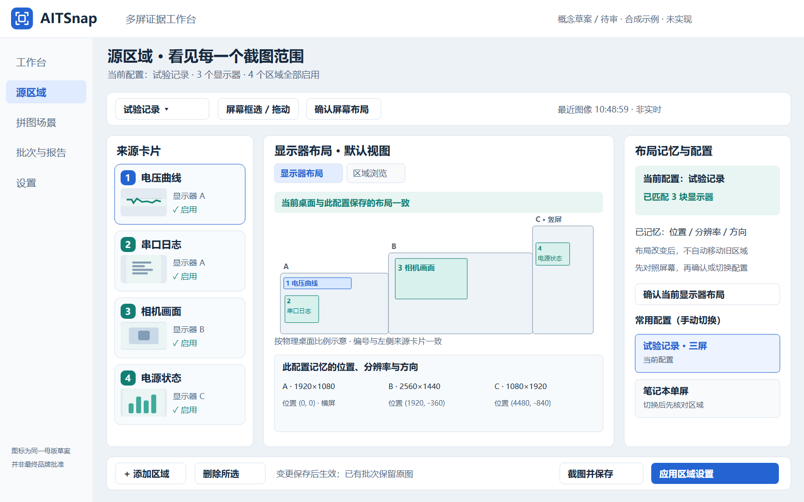
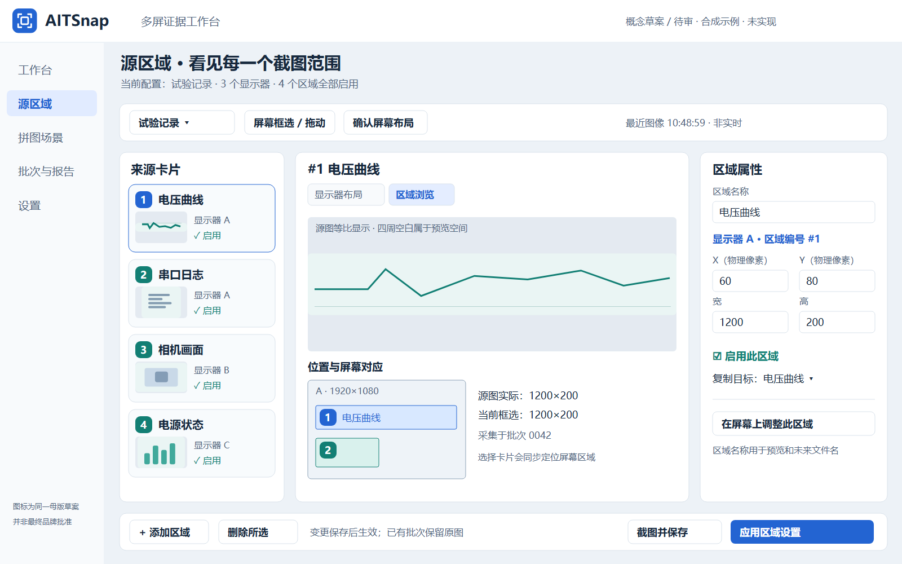
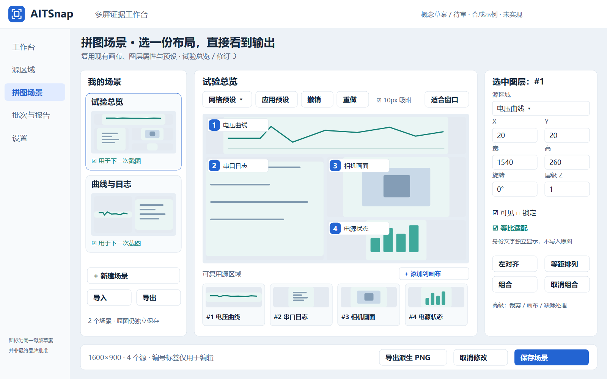
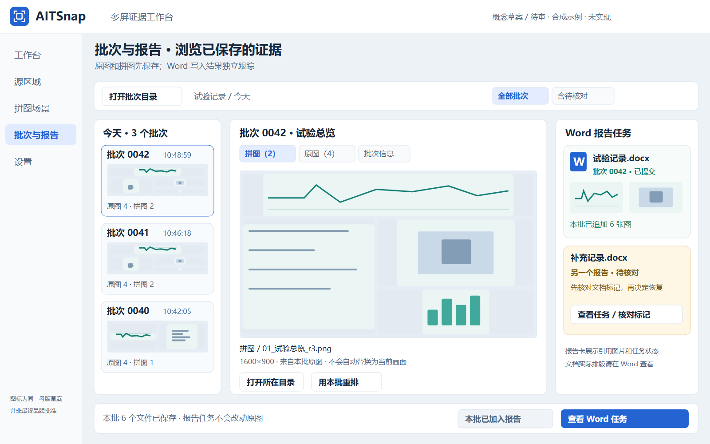
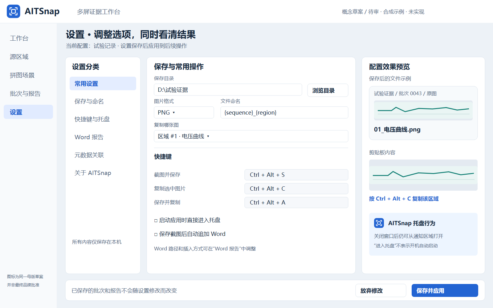

# 四个选项卡的浏览式概念设计

Owner 对上一版工作台草图给予方向性肯定，本次补充源区域、拼图场景、批次与报告、设置四页。**这是新的待审概念图，不是已实现页面或现场截图。** 演示数据与图像全部为合成示例；产品代码未改动。

打开[五个导航页审计面板](concepts/tab-review-board.html)，可用顶部页签或图内左侧导航切换工作台及四个新页面。键盘左右箭头也可切换顶部页签。其他图内控件只是静态示意，不执行截图、安装、保存或 Word 操作。

最新Owner要求已反映在**概念面板**：源区域的顺序是“显示器布局 → 区域浏览”，每次从主导航进入源区域默认回到显示器布局。两个子页签及布局变化示例可切换。记忆能力核对和后续缺口见[显示器布局说明](DISPLAY-LAYOUT.md)；产品尚未实现此导航改动。

## 一、源区域：卡片选择 → 看图 → 定位屏幕 → 编辑属性

左侧列出 `#编号＋名称＋缩略图＋显示器归属`；中间默认呈现多屏布局，切换区域浏览后显示等比源图及屏幕定位。布局页右侧说明布局与配置，区域浏览右侧保留现有名称、坐标、宽高、启用和复制目标。高级精确数值仍可直接编辑，日常浏览无需先读坐标表。

- **沿用**：配置选择、区域新增/删除/启用、坐标模型、原生屏幕框选/拖动、屏幕布局确认、复制目标、配置应用和截图动作。来源：`src/main_window.cpp`、`src/desktop/region_editor.cpp`。
- **改造展示**：把区域表的编辑数据映射到卡片和属性面板；复用最近批次源图构造预览；小显示器示意与卡片双向选中。
- **需要新增**：稳定编号与名称映射（N03）、源图尺寸/当前区域尺寸和批次时间提示、缩略图/定位高亮。
- **不隐含新增**：实时桌面流、自动后台重拍或OCR。未采集时明确缺源；改框选后保留旧批次，不静默篡改预览。

审计点：源列表在左、图像及定位在中、精确属性在右是否自然？保持现有“在屏幕上框选”作为明确动作，而不是把缩略图坐标当作屏幕物理坐标。

## 二、拼图场景：场景缩略图 → 原有画布 → 原有图层属性

左侧场景列表增加可视缩略图和“用于下一次截图”状态；中间继续使用现有 `QGraphicsView/SceneEditor` 画布与预设、撤销重做、缩放/吸附；可复用源在下方图像条中选择后添加到画布；右侧保留已有图层控制。

- **沿用**：画布渲染、预设、图层位置/宽高/旋转/Z、可见/锁定/等比、裁剪、对齐/分布、组合、撤销重做、源复用、场景导入导出、派生PNG导出。来源：`src/desktop/scene_editor.*`、`scene_layer_item.h`、`src/adapters/scene_render.*`。
- **改造展示**：现有场景列表以自定义delegate画缩略图；复用 `renderScene`，不另写一套“预览渲染器”；对话框可提取可嵌入的编辑面板，保留原对话框入口，业务和撤销状态不复制。
- **需要新增**：独立清晰的身份覆盖层（N05）、卡片与图层联动，以及未保存修改时的离开处理。
- **来源真实边界**：缩略图使用已取得的源或明确占位；截图内原有文字不转为可编辑标签。图中编号是独立编辑器文字，默认不进入派生图。

这页以重排现有控件为主；编号与独立文字属于已规划的基础修复，不能靠换皮省略。绘制中保留“添加到画布”按钮，没有把尚未实现的直接拖放描述成现有能力。

## 三、批次与报告：批次胶片 → 保存图像浏览 → Word任务卡

左侧以时间和输出缩略图选择批次；中间查看这个批次的拼图/原图，提供所在目录、文件信息及“用本批重排”；右侧将现有 Word 队列以报告卡展示，区分已提交、修改前失败、待核对等状态。

- **沿用**：`batch.json`、已保存图片、`loadHistoricalSources`、历史重排和原始SHA核对；`ReportQueue` 的状态/排队/已确认修改前失败重试/文档标记核对。来源：`src/adapters/capture_files.*`、`scene_render.*`、`report_queue.*`，以及 `MainWindow::showReportJobs/editScene`。
- **需要新增**：已选目录内的批次发现适配层、按需缩略图缓存、列表/图片/报告的选择联动。**当前没有完整的集成批次画廊**，不能宣称这里只需改几个按钮。
- **保持小范围**：从已知输出目录或用户显式选择的批次开始，按需读取manifest/缩略图；不递归扫描全部磁盘、不为浏览强行引入新数据库，也不在UI线程重复哈希所有历史文件。
- **报告浏览边界**：卡片中的图像是关联插图与任务状态，**不是 Word 实际页截图**；实际文档布局在Word查看。若以后需要逐页真实缩略图，应单独验证Word导出/渲染能力，不伪造页面。
- **恢复边界**：待核对任务先核对标记，不能画成一键盲目重试。示例中“补充记录.docx”是另一个报告，不能据此推断同一报告可越过不确定任务继续写入。
- **重复追加**：已关联的当前批次显示禁用的“本批已加入报告”；没有提交过时才显示正常追加入口，底层幂等/身份规则继续保留。

此页的核心能力可复用，新增量集中在只读浏览与展示组织。文件名示例采用N04目标格式，不代表0.6.2已去除UUID。

## 四、设置：沿用已有配置，加入“效果预览”

左侧是设置分类；默认“常用设置”汇总已有保存、复制、热键和托盘选项；中间使用原有表单控件；右侧展示保存后的文件示例、剪贴板内容和托盘行为示意。其他分类可进一步展开，避免一次堆满所有选项。

- **沿用**：保存目录、PNG/JPEG/BMP、现有命名token、复制源、三组热键、启动时进托盘、Word路径/模式/布局、试验元数据及已有配置保存校验。来源：`src/main_window.cpp`、`src/adapters/json_store.*`。
- **需要新增**：分类导航和配置草稿的可视化效果预览；在保存前从同一份候选配置生成文件示例，不能预览一份、保存另一份。
- 命名字段使用已有 `{sequence}/{region}` 语义；更友好的可读命名依赖N04，不新增一套未经定义的中文token解析器。
- “启动应用时进入托盘”**不是开机自启**；不添加当前没有实现的云同步、自动更新、系统权限修改或后台抓图。
- 右侧只用既有批次或明确合成/缺源状态示意效果；修改设置不覆盖历史图片，不实际写剪贴板，不自行启动Word。

## 与原开发路线的对应

| 选项卡 | 主要复用点 | 新展示层 | 路线依赖 |
| --- | --- | --- | --- |
| 源区域 | 区域表数据、坐标/原生编辑、配置控制器 | 卡片、图像预览、屏幕定位 | N03、N07、N08 |
| 拼图场景 | SceneEditor/QGraphicsView及已有图层操作 | 场景缩略图、嵌入布局、身份文字 | N03、N05、N07、N08 |
| 批次与报告 | manifest/历史源读取、ReportQueue | 批次发现、缩略图、报告卡与联动 | N04、N07、N08；本表增加浏览适配任务 |
| 设置 | Settings、原表单、保存/热键校验 | 分类、草稿效果预览 | N04、N07 |

实施时先复用控制器和模型，再提取可嵌入视图；不要为了四个页签重写截图、拼图渲染、Word COM或队列。仅效果预览新增，不在概念绘制轮实现产品。

## 文件与生成

新文件：`04-sources-tab`、`05-scenes-tab`、`06-batches-reports-tab`、`07-settings-tab`，均有SVG和1600×1000PNG。统一复用 `generate_concepts.py` 的绘制组件和同一品牌草案。`generate_tab_concepts.py` 仅生成这四页及五页审计面板，导入公共组件不会重写先前概念资产。

原来的 `02-region-selection` 和 `03-scene-composer` 保留，作为编辑器细节示意；这四张新图对应导航选项卡，不能用一张编辑器细节图冒充整个导航页面。
