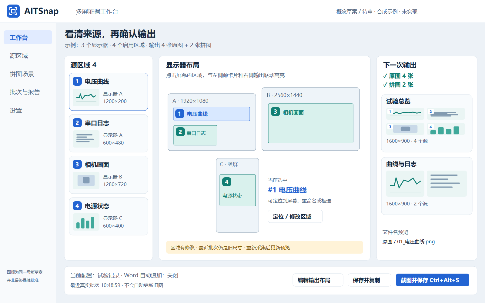
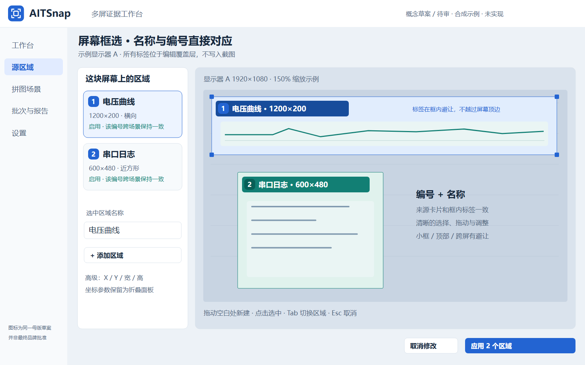
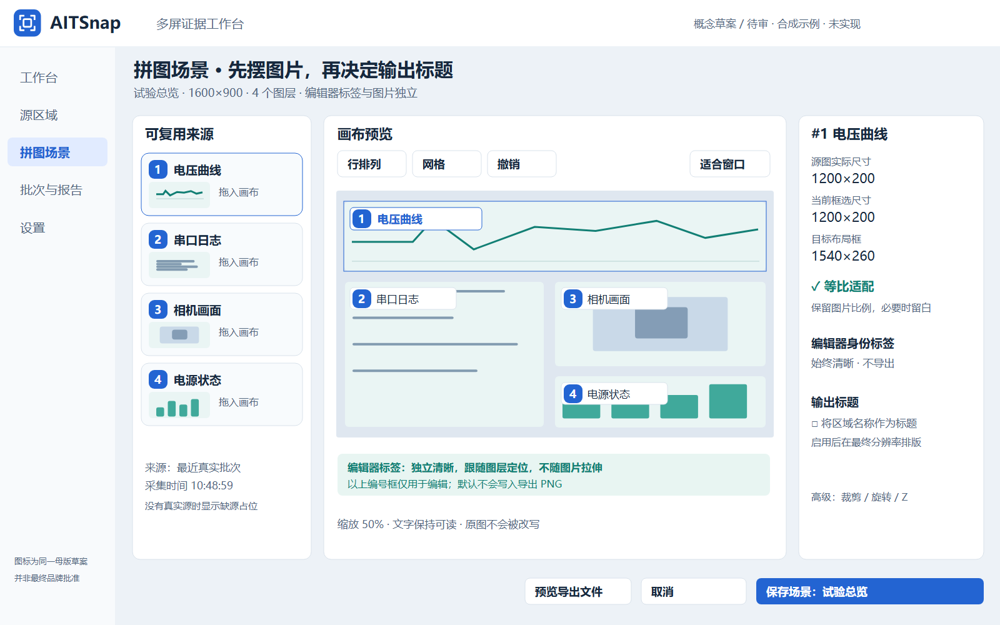

# UI 概念审计

状态：**设计草案，未实现，未获 Owner 最终审定。** 所有显示器、曲线、日志、相机图形及文件名均为合成示例，不代表现场捕获。图中坐标与布局是信息架构示意，不是可作为物理像素标定依据的截图。

打开[三页审计面板](concepts/review-board.html)，可切换“工作台总览 / 多屏框选 / 拼图编辑”；切换之外的按钮只是示意，不会截图、安装或写入产品数据。独立 PNG 可直接交给其他 AI，SVG 和生成脚本供继续编辑。

## 概念一：工作台总览

- 左：来源卡片，显示相同的编号/名称、显示器归属、尺寸、可用状态。
- 中：多屏拓扑，直接画出每块屏上的区域；卡片、框、输出之间联动高亮。单选后提供定位/修改，不必在坐标表中猜测。
- 右：下一次实际启用的输出，包括原图数、拼图数和每个拼图的预览。保存前即可看见可读文件名。
- 底部：稳定的保存/复制主动作、配置/Word状态；旧批次与当前区域不一致时明确提醒重新采集。
- 现有坐标表改为高级参数入口，保留精确编辑能力，不作为主界面。

待审：三栏宽度和信息密度是否合适？右栏是否需要默认显示Word报告状态？推荐把常用动作固定，批次/队列详情按需展开。

## 概念二：框选时就能识别区域

- 每个框内有 `#1 电压曲线` 这种身份标签，和源卡片一致；尺寸为次要信息，UUID不占据普通界面。
- 名称可直接编辑，编号是稳定身份提示；选中态明显，编号之外仍显示名称，颜色不能成为唯一映射方式。
- 顶部、小框、跨屏有标签钳制/避让。对窄小区域可外置标签并用短引线关联，不让标签遮掉调整手柄。
- 本图在应用画布中示意一块屏幕的编辑状态。真正“在屏幕上框选”仍应使用已有逐屏原生覆盖层和捕获隔离；不要把概念缩略画布坐标直接写成物理屏幕坐标。

待审：接受配置内稳定编号（删除留空号）还是每次显示连续序号？推荐稳定编号，避免同一来源在文件和场景中不断换号。任何方案均保留内部UUID，并在每批manifest中冻结当时的可读身份。

## 概念三：图片与文字解耦

- 左：可复用源卡片；拖入画布后始终知道来自哪个区域。相同源的副本共用源号，实例另有可读名称。
- 中：真实源/缺源背景属于图片层；编号和名称属于编辑器覆盖层。缩放/旋转图片时，标签保持可读，默认不导出。
- 右：同时呈现“源图实际尺寸、当前框选尺寸、目标布局框”，解释可能的留白和旧批次差异。
- “等比适配”默认开；取消后才是显式拉伸。图层目标框的比例不等于源图比例，这是自由布局能力，不应被误认为源像素已改变。
- “输出标题”是第三个语义层：按需开启，在导出最终像素分辨率上单独排版；Word需要可编辑文字时生成段落/Caption。

待审：编辑器身份标签是否默认常显？推荐常显，提供临时隐藏快捷键；导出标题默认关闭，防止软件标签污染证据图。

## 图标草案与交付口径

[品牌标识草案](concepts/brandmark-proposal.svg)只有一个图形定义，三张概念图复用同一图形。它用于审计“捕获边角＋画面”的方向，**尚不是已采用的正式Logo**。正式实施须确定一个SVG母版及多尺寸派生，而非根据每张图重新生成相似标识。

原始 `.msi` 文件的Shell图标与应用EXE/快捷方式图标不同。若Owner坚持分发文件本身也统一，按路线N06提供带同源图标的薄setup.exe主入口；不修改全局MSI文件关联，也不借此规避安装器UI自动化限制。

## 给接手实现者

不要逐像素照抄概念图而破坏现有事件/捕获/Word控制器。先完成编号、命名和overlay基础，再替换主视图。缺少Owner新审计时，可做可逆布局原型及独立基础修复，最终视觉验收继续HOLD。UI中不出现架构术语、数据表名、UUID、渲染模式实现细节或预算/测试状态。

文件：

- `01-workbench.png/.svg`：总览。
- `02-region-selection.png/.svg`：来源框选。
- `03-scene-composer.png/.svg`：拼图与标签分层。
- `review-board.html`：可离线切换三页；不使用外部脚本、字体、网络或账户。
- `generate_concepts.py`：仅生成合成设计文件，不读取用户截图，不是产品源码。
